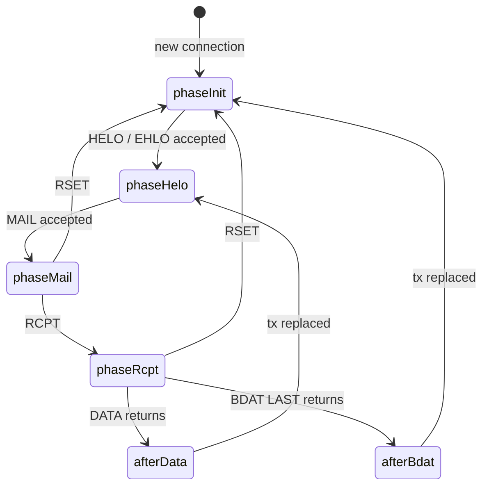

# Handler guide

This guide walks through one SMTP transaction phase by phase. It shows which
`Tx` fields are populated at each step and when each callback fires. The
normative rules are clauses H1 to H8 in [spec.md](spec.md). If this guide and
the spec disagree, the spec wins.

## Transaction lifecycle



A `Tx` is created at connection start and replaced after RSET, after DATA, and
after a successful `BDAT ... LAST`. `tx.Rcpts` accumulates every presented
recipient. `tx.Accepted` contains the ones the handler accepted. `Data` runs
only when `len(tx.Accepted) > 0`.

After RSET the client does not need to send HELO again. After DATA or BDAT LAST
the client needs a new MAIL. In both cases the transaction fields are cleared.

## Phase-by-phase walkthrough

### 1. Connection opened: phaseInit

The server sends `220 <hostname> ESMTP` and creates a `Tx`:

| Field | Value |
|---|---|
| `tx.RemoteAddr` | client's remote address |
| `tx.Hostname` | server's advertised hostname |
| `tx.TLS` | nil until TLS is active. Set for STARTTLS and implicit TLS (C7) |
| `tx.Helo` | empty |
| `tx.MailFrom` | empty |
| `tx.Params` | empty map, not nil |
| `tx.Rcpts` | nil |
| `tx.Accepted` | nil |
| `tx.Rejected` | nil |

### 2. HELO / EHLO: phaseHelo

The client identifies itself. The server validates the argument, then calls
`Handler.Hello(ctx, tx)`.

| Field | Value |
|---|---|
| `tx.Helo` | client's HELO/EHLO domain |
| `tx.Hostname` | already set, now sent in the EHLO response |

- Return a non-250 response to reject the greeting. The session stays open but
  cannot start a transaction.
- Any 250 message from `Hello` is replaced with the server hostname.
- After EHLO the server advertises PIPELINING, 8BITMIME, ENHANCEDSTATUSCODES,
  SMTPUTF8, CHUNKING, `SIZE <bytes>`, and STARTTLS when TLS is configured.
- A later HELO or EHLO is accepted. It resets the transaction as if RSET had
  run (RFC 5321 §4.1.4). A rejected greeting leaves the state unchanged.

### 3. MAIL FROM: phaseMail

The client specifies the envelope sender. The server parses `FROM:<path>` and
the parameters, checks the `SIZE` parameter, then calls
`Handler.MailFrom(ctx, tx)`.

| Field | Value |
|---|---|
| `tx.MailFrom` | envelope sender. Empty string means the null sender `<>` |
| `tx.Params` | parameters, keys upper-cased: `SIZE`, `BODY`, `SMTPUTF8` |

- Reject the sender by returning a non-250 response.
- A `SIZE` value above the limit returns 552 before the callback. The `BODY`
  parameter is not validated here; the 8-bit check runs after DATA.
- Plaintext MAIL is accepted by default. Setting `RequireTLS` returns 530
  until the client upgrades.

### 4. RCPT TO: phaseRcpt

The client specifies one recipient per command. The server calls
`Handler.RcptTo(ctx, tx)` for each.

| Field | Value |
|---|---|
| `tx.Rcpts` | all recipients presented so far, accepted and rejected |
| `tx.Accepted` | recipients the handler accepted |
| `tx.Rejected` | recipients the handler rejected, with the response |

- The presented recipient is the **last element** of `tx.Rcpts`. Use
  `tx.Rcpts[len(tx.Rcpts)-1]`.
- Return 250 to accept. Any other code rejects this recipient only.
- `MaxRecipients` is checked before the callback. Exceeding it returns 452.
- `RCPT TO:<Postmaster>` arrives unchanged. RFC 5321 §4.5.1 requires support
  for the postmaster mailbox; the handler must accept it.

### 5. DATA or BDAT LAST: handlerData

For DATA, the server reads the dot-stuffed body, removes the stuffing, and
passes the raw RFC 5322 bytes to `Handler.Data(ctx, tx, body)`.

For BDAT, each non-LAST chunk accumulates in a buffer. Only the LAST chunk calls
`Data`, with the concatenated body.

| Field | Value |
|---|---|
| `tx.Accepted` | final list of accepted recipients |
| `tx.Params` | MAIL parameters, used for the 8BITMIME check |

- `Data` runs only if at least one recipient was accepted.
- Return non-250 to bounce the message.
- If `PostcatDir` is set and you return 250, the server writes a postcat file
  after the callback returns. The write is best effort.
- Copy the body before you keep it. The server does not promise its lifetime.
- The 8-bit rule: a body with bytes above 127 is rejected with 550 unless MAIL
  carried `BODY=8BITMIME` or `SMTPUTF8`. BDAT chunks skip this check.
- Your callback runs on the worker goroutine and blocks the client. There is no
  handler deadline. Honour `ctx` and keep the call short.

### 6. RSET

The client resets the transaction. A fresh `Tx` replaces the current one. No
callback runs. HELO state is kept.

### 7. STARTTLS

If `TLSConfig` is set, the client can issue STARTTLS after EHLO. After a
successful handshake the server discards the HELO state; the client must send
EHLO again. `tx.TLS` is populated with the connection state.

The server does not advertise STARTTLS again after the handshake. Plaintext
MAIL is accepted unless `RequireTLS` is set. Implicit TLS through a `tls.Listener` also
populates `tx.TLS` (C7).

## Handler contract invariants

| Invariant | Detail |
|---|---|
| Return nil becomes 503 | Use the `Resp*` constants to accept. Do not mutate them; call `Copy()` |
| Serial per connection | Hello, MailFrom, RcptTo, Data run in order on one goroutine |
| Concurrent across connections | One handler instance serves all connections. Guard shared state |
| `tx` is read-only | The server manages `Tx`. Handlers read, they do not write |
| Data needs an accepted recipient | All recipients rejected means no Data call |
| Hello 250 is replaced | The message is overwritten with the server hostname |
| STARTTLS resets EHLO | The client must greet again after the upgrade |
| A panic drops the connection | The server logs `handler_panic` and closes. It sends no 451 |

## Configuration quick reference

| Goal | Approach |
|---|---|
| Reject at HELO | Return non-250 from `Hello` |
| Reject sender | Return non-250 from `MailFrom` |
| Accept or reject a recipient | Return 250 or non-250 from `RcptTo` |
| Store or reject the message | `Data` gets the raw bytes; return 250 to accept |
| Enable STARTTLS | Set `Server.TLSConfig` or use `WithTLSConfig(cfg)`. TLS stays optional |
| Require TLS before MAIL | Set `Server.RequireTLS` or use `WithRequireTLS(true)` |
| Enable SMTPS | Pass a `tls.Listener` to `Serve` |
| Limit message size | `Server.MaxMessageSize` or `WithMaxMessageSize(n)` |
| Limit recipients | `Server.MaxRecipients` or `WithMaxRecipients(n)` |
| Limit connections | `Server.MaxConnections` or `WithMaxConnections(n)` |
| Structured logging | `WithLogger(NewSlogLogger(slog.Default()))` |
| Persist to disk | `Server.PostcatDir` or `WithPostcatDir(dir)` |

## Worked example: reject one recipient

```go
func (h *handler) RcptTo(ctx context.Context, tx *smtp.Tx) *smtp.Response {
    rcpt := tx.Rcpts[len(tx.Rcpts)-1]
    if !strings.HasSuffix(rcpt, "@example.com") {
        return &smtp.Response{Code: 550, Message: "5.1.1 Relaying denied"}
    }
    return smtp.RespRcptOK
}
```

A 550 here rejects only this recipient. The client may send more RCPT commands.
If every recipient is rejected, the client gets 554 on DATA and `Data` is never
called.

## Worked example: reject the message after DATA

```go
func (h *handler) Data(ctx context.Context, tx *smtp.Tx, body []byte) *smtp.Response {
    if bytes.Contains(body, []byte("X-Spam: yes")) {
        return &smtp.Response{Code: 554, Message: "5.7.1 Rejected as spam"}
    }
    return smtp.RespDataOK
}
```

The transaction is reset after the callback, whether it returns 250 or not.
