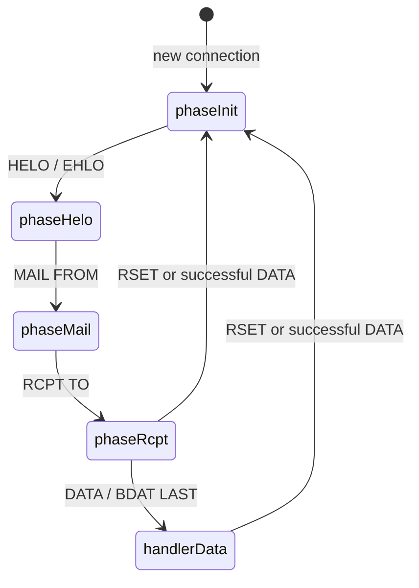

# Handler Guide

This guide walks through a complete SMTP transaction phase by phase, showing
which `Tx` fields are populated at each step and when each callback fires.
Read the [package documentation](https://pkg.go.dev/github.com/stupoid/smtp-gateway)
for the full Handler contract invariants.

## Transaction lifecycle

A `Tx` is created at connection start and replaced after RSET or successful
DATA/BDAT LAST. `tx.Rcpts` accumulates all presented recipients;
`tx.Accepted` contains those the handler accepted. DATA is only called if
`len(tx.Accepted) > 0`.

## Phase-by-phase walkthrough

### 1. Connection opened → phaseInit

A client connects. The server sends the banner and a new `Tx` is created:

| Field | Value |
|---|---|
| `tx.RemoteAddr` | client's remote address |
| `tx.Hostname` | server's advertised hostname |
| `tx.TLS` | nil (until STARTTLS) |
| `tx.Helo` | empty |
| `tx.MailFrom` | empty |
| `tx.Params` | nil |
| `tx.Rcpts` | nil |
| `tx.Accepted` | nil |
| `tx.Rejected` | nil |

### 2. HELO / EHLO → phaseHelo

The client identifies itself. The server calls `Handler.Hello(ctx, tx)`.

| Field | Value |
|---|---|
| `tx.Helo` | client's HELO/EHLO domain |
| `tx.Hostname` | already set (now sent in EHLO response) |

- Return a non-250 response to reject the connection.
- Any 250 response message from Hello is replaced with the server hostname
  (per RFC 5321 §4.3.2).
- After EHLO, the server advertises capabilities: PIPELINING, STARTTLS
  (if TLSConfig is set), 8BITMIME, SMTPUTF8, SIZE, CHUNKING, and
  ENHANCEDSTATUSCODES.

### 3. MAIL FROM → phaseMail

The client specifies the envelope sender. The server calls
`Handler.MailFrom(ctx, tx)`.

| Field | Value |
|---|---|
| `tx.MailFrom` | envelope sender (empty string `""` = null sender `<>`) |
| `tx.Params` | key=value parameters (SIZE, BODY, SMTPUTF8, etc.) |

- Reject the sender by returning a non-250 response.
- SIZE and BODY=8BITMIME parameters are validated by the server before
  the callback; violations trigger a 552 or 550 response respectively.

### 4. RCPT TO → phaseRcpt

The client specifies one recipient per command. The server calls
`Handler.RcptTo(ctx, tx)` for each.

| Field | Value |
|---|---|
| `tx.Rcpts` | all recipients presented so far (accepted + rejected) |
| `tx.Accepted` | subset of Rcpts accepted by the handler |
| `tx.Rejected` | subset of Rcpts rejected, with rejection reasons |

- The most recently presented recipient is the **last element** of
  `tx.Rcpts`. Use `tx.Rcpts[len(tx.Rcpts)-1]` to inspect it.
- Return 250 to accept this recipient; any other code to reject it.
- The server enforces `MaxRecipients` before calling the handler.

### 5. DATA / BDAT LAST → handlerData

The client sends the message body. For DATA, the server reads the
dot-stuffed body, dot-unstuffs it, and passes the raw RFC 5322 bytes to
`Handler.Data(ctx, tx, body)`.

For BDAT, each non-LAST chunk accumulates in a buffer; only the LAST
chunk triggers the Data callback with the concatenated body.

| Field | Value |
|---|---|
| `tx.Accepted` | final list of accepted recipients |

- Data is **only called** if at least one recipient was accepted.
- Return non-250 to reject the message (transient or permanent).
- If `PostcatDir` is configured and the handler returns 250, the server
  writes a postcat file after the callback returns.

### 6. RSET

The client resets the transaction. A fresh `Tx` replaces the current one —
all fields return to their phaseInit values. No handler callback is invoked.

### 7. STARTTLS (optional)

If `TLSConfig` is set, the client can issue STARTTLS during phaseInit or
phaseHelo. After a successful TLS handshake, `tx.Helo` and the EHLO cache
are reset — the client must re-issue EHLO. After STARTTLS, `tx.TLS` is
populated with the connection's TLS state.

## Handler contract invariants

These are the rules every Handler implementation must follow:

| Invariant | Detail |
|---|---|
| **Return nil → 503** | If a callback returns nil, the server substitutes `503 Bad sequence`. Use `Resp*` constants (or `Resp*.Copy()` for mutable versions). |
| **Serial per connection** | Within a single connection, Hello → MailFrom → RcptTo× → Data are called sequentially from the worker loop. No per-connection locking needed. |
| **Concurrent across connections** | The same Handler handles all connections. Use `sync.Mutex` or channels for shared mutable state. |
| **tx is read-only** | Don't mutate Tx fields — the server manages them. Handlers read, they do not write. |
| **Data only fires with accepted recipients** | If all RCPT TOs are rejected, Data is skipped and the client gets the rejection codes. |
| **Hello 250 message replaced** | Any 250 response from Hello has its message overwritten with the server hostname. |
| **STARTTLS resets EHLO state** | After a successful TLS handshake, the server forgets the prior HELO/EHLO domain. The client must re-issue EHLO. |

## Configuration quick reference

| Goal | Approach |
|---|---|
| Reject at HELO | Return non-250 from `Hello` |
| Reject sender | Return non-250 from `MailFrom` |
| Accept/reject per recipient | Return 250/non-250 from `RcptTo` |
| Store/reject message | `Data` gets raw bytes; return 250 to accept |
| Enable STARTTLS | Set `Server.TLSConfig` or use `WithTLSConfig(cfg)` |
| Enable SMTPS | Pass a `tls.Listener` to `Serve` |
| Limit message size | `Server.MaxMessageSize` or `WithMaxMessageSize(n)` |
| Limit recipients | `Server.MaxRecipients` or `WithMaxRecipients(n)` |
| Limit connections | `Server.MaxConnections` or `WithMaxConnections(n)` |
| Structured logging | `WithLogger(NewSlogLogger(slog.Default()))` |
| Persist to disk | `Server.PostcatDir` or `WithPostcatDir(dir)` |
